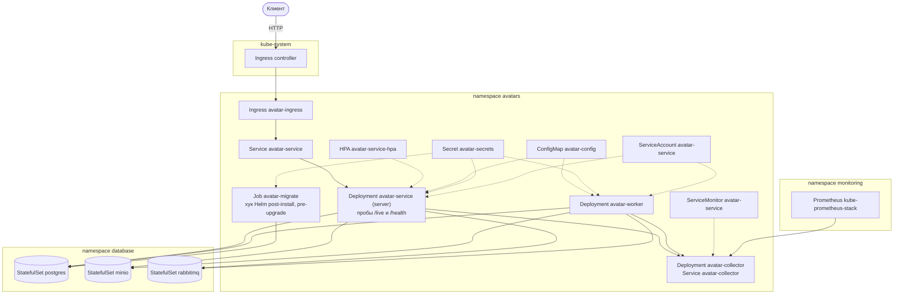

# GophProfile

Сервис GophProfile хранит аватарки пользователей и раздаёт их другим сайтам.
Картинку загружают через REST API или веб-страницу, worker через RabbitMQ
делает миниатюры 100×100 и 300×300 и удаляет файлы.

Метаданные лежат в Postgres, файлы в MinIO.

## Документация

```text
POST   /api/v1/avatars                        # загрузка, файл в поле file или image формы
GET    /api/v1/avatars/{id}                   # файл, ?size=100x100|300x300 и ?format=jpeg|png|webp
GET    /api/v1/avatars/{id}/metadata          # размеры, формат, статус и миниатюры
GET    /api/v1/users/{user_id}/avatars        # все аватарки пользователя
GET    /api/v1/users/{user_id}/avatar         # текущая аватарка, те же size и format
DELETE /api/v1/avatars/{id}                   # удаление своей аватарки
DELETE /api/v1/users/{user_id}/avatar         # удаление своей текущей аватарки
GET    /health                                # состояние Postgres, S3 и RabbitMQ
GET    /web/upload                            # страница загрузки
GET    /web/gallery/{user_id}                 # галерея пользователя
```

Пользователь передаётся в заголовке `X-User-ID`. Форматы jpeg, png и webp,
файл до 10 МБ, с одного IP не больше 100 запросов в минуту.

Спецификация API в формате Swagger 2.0 лежит в `api/swagger.yaml` и
`api/swagger.json`. Её строит swag из аннотаций в `internal/api/routes.go`
командой `go generate ./internal/api`.

## Запуск

### Docker Compose

Нужен Docker. Команды вызываются из корня репозитория.

```sh
docker compose up -d --build   # сервис на http://localhost:8080, RabbitMQ на http://127.0.0.1:15672
docker compose down            # остановка с сохранением данных
docker compose down -v         # остановка с удалением данных
```

### Kubernetes

Нужен Rancher Desktop с dockerd. Сервис отвечает на http://avatars.localhost.

```sh
docker build -t avatar-service:latest .
helm repo add prometheus-community https://prometheus-community.github.io/helm-charts
# без имени monitoring Prometheus не увидит ServiceMonitor чарта
helm install monitoring prometheus-community/kube-prometheus-stack -n monitoring --create-namespace --set alertmanager.enabled=false
helm install gophprofile helm/gophprofile -n default -f helm/gophprofile/values-dev.yaml --timeout 10m
# новый образ ставится только под новым тегом
docker build -t avatar-service:v2 .
helm upgrade gophprofile helm/gophprofile -n default -f helm/gophprofile/values-dev.yaml --set image.tag=v2 --timeout 10m
# удаление вместе с данными Postgres, MinIO и RabbitMQ
helm uninstall gophprofile -n default --wait
```

С `values-prod.yaml` пароли передаются флагами `--set secrets.postgresPassword=…`,
`--set secrets.minioPassword=…` и `--set secrets.rabbitmqPassword=…`.

## Архитектура



## Логи

server и worker пишут JSON в stdout и через collector в OpenSearch Dashboards
на http://127.0.0.1:5601. Уровень задаёт `LOG_LEVEL`: `debug`, `info`, `warn`
или `error`. Записи одного запроса ищутся в Discover по trace ID из Jaeger на
http://127.0.0.1:16686: `traceId:<trace ID>`. Монитор «Ошибки в логах» раз в
минуту ищет записи ERROR.

## Метрики

Prometheus на http://127.0.0.1:9090 собирает метрики server и worker через
collector и глубину очередей с RabbitMQ. В Grafana на http://127.0.0.1:3000 в
папке GophProfile дашборды Service overview, RED, Resources и Business KPI.

## Алерты

Prometheus проверяет правила из `alerts.yml` и отправляет алерты через
Alertmanager на http://127.0.0.1:9093 в заглушку `alert-webhook`, уведомления
видны в `docker compose logs -f alert-webhook`.

```text
HighErrorRate      # warning, больше 10% загрузок за 5 минут с ошибкой сервиса
HighResponseTime   # critical, 95% загрузок за 5 минут дольше 5 с
ServiceDown        # critical, server или worker 1 минуту не присылает метрики
```
